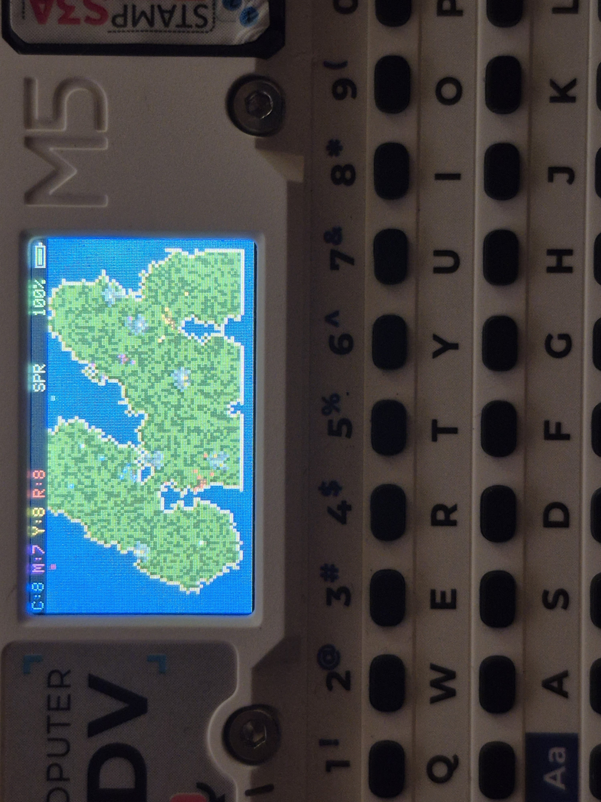
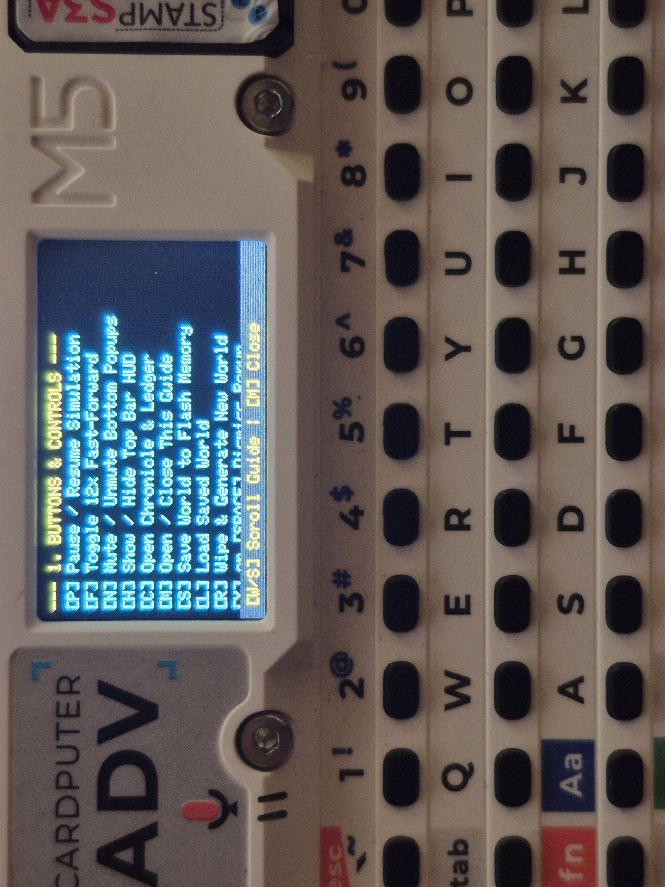
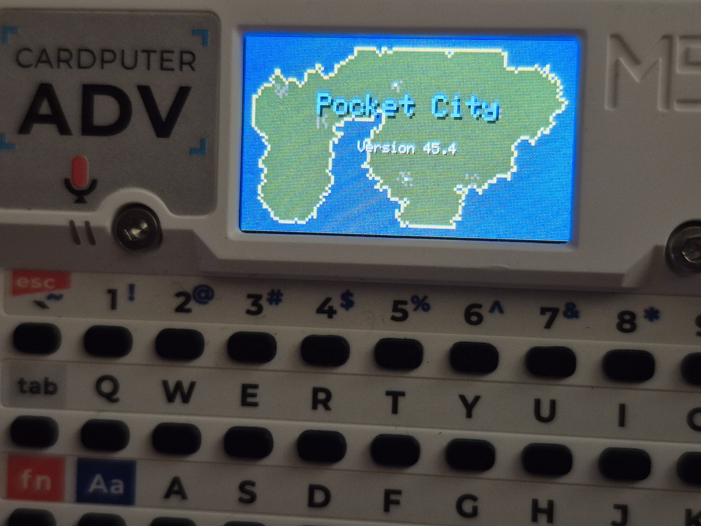

# Pocket City for M5Stack Cardputer

**Pocket City** is a macro-historical civilization and ecology simulator built exclusively for the M5Stack Cardputer. 

Turn your device into a living, breathing desk terrarium. Watch as tiny tribal bands forage for food, evolve into massive global empires, wage wars, terraform the landscape, and eventually face their own hubris through nuclear fallout or a rogue AI Singularity.

## Features
- **A Living Planet:** A wrap-around globe featuring dynamic weather, continental drift, seasons, moving rainstorms, and volcanic islands that rise from the ocean.
- **Asymmetric Evolution:** Tribes in lush river valleys will quickly build stone cities and ports, while tribes trapped in the arid desert or alpine tundra must struggle as farming villages.
- **Organic Urban Growth:** Metropolises dynamically form tendrils that hug coastlines, rivers, and highways, complete with downtown cores, timber suburbs, and protected greenbelt farms.
- **Global Warfare & Colonization:** Empires launch tribal raids, medieval castle sieges, and atomic era nuclear exchanges. Factions will board ships to colonize distant, fertile continents.
- **The Cycle of Hubris:** Advanced empires that pave over their farms with factories will suffer famine, rebellions, and devastating AI Uprisings, eventually learning to rebuild as peaceful Eco Stewards.

## Installation
Pocket City is distributed as a compiled binary file (`.bin`). You do not need to compile any code to run it.

1. Go to the [Releases](../../releases) tab on this repository.
2. Download the latest `Pocket_City_v45.4.bin` file.
3. Go to https://web.esphome.io/.
4. Connect your **Cardputer ADV** to your computer and identify the COM port.
5. Select the **Upload** option.
6. Choose the downloaded `.bin` file and flash it directly to your Cardputer.

## Controls & HUD
| Key | Action |
| :--- | :--- |
| **Z** | Toggle Screen / Charging Mode |
| **P** | Pause / Resume simulation |
| **F** | Toggle 12x Fast-Forward mode |
| **C** | Open the Chronicle & Ledger |
| **M** | Open the in-game Field Guide |
| **H** | Toggle top HUD visibility |
| **N** | Mute / Unmute bottom popups |
| **S** | Save world state to flash memory |
| **L** | Load saved world |
| **R** | Wipe & Generate a brand new world |

### Understanding the HUD
- **Top Bar:** Shows live population for Cyan, Magenta, Yellow, and Red, the current Season, and your hardware battery percentage.
- **Ledger [C] Tags:** 
  * `Trb.` (Tribe), `Vlg.` (Village), `Kdm.` (Kingdom)
  * `Emp.` (Aggressive), `Rep.` (Industrious), `Unn.` (Balanced)
  * `Dec.` (Decadent - Rich but weak), `Eco.` (Post-collapse nature stewards)
  * `Ast.` (Spacefaring), `Cyb.` (AI Cyber-Collective)

## Credits
Created by JTrenholm
